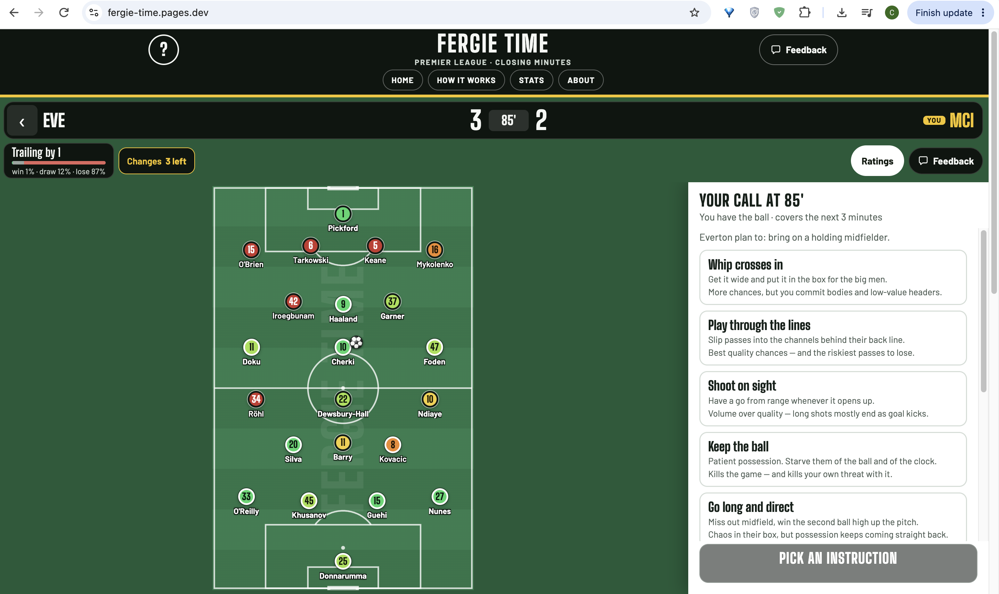
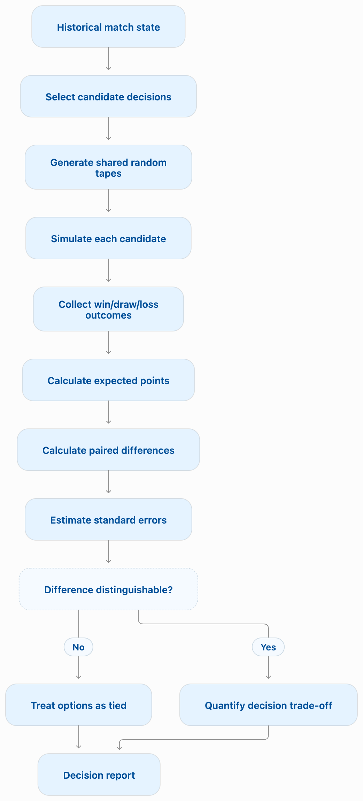
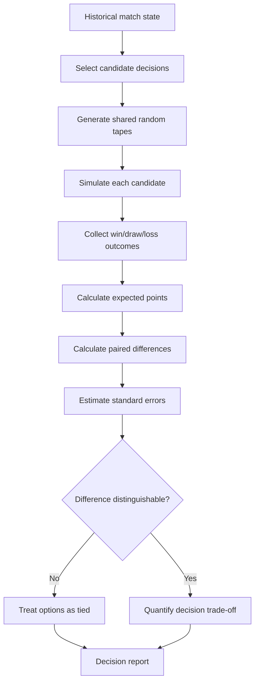

# Fergie Time: Premier League Football Analytics & Decision Simulation

**An interactive Premier League tactical decision game built around historical match-event data, Monte Carlo simulation, and model evaluation.**

> [**Play Fergie Time**](https://fergie-time.pages.dev/)

Fergie Time puts you in charge of a real Premier League match during its closing stages. You make tactical decisions, simulate their possible consequences, and receive an evaluation of each decision based on expected points and outcome probabilities.

This repository is a public technical showcase of the analytical methods, evaluation approach, and selected reproducible examples behind the project. It is not the application source code or a reproduction of the production simulation engine.

## Application/Game preview



## Simulation workflow

<!--  -->



## Project overview

The project explores a practical decision problem:

> **Given a football match's current state, how can we compare alternative tactical decisions when the eventual outcome is uncertain?**

The application uses historical Premier League match-event data, including match results, lineups, shots, shot locations, and player information.

For each decision, the simulation evaluates alternative tactical options and reports:

- Expected points, using 3 points for a win, 1 for a draw, and 0 for a loss.
- Win, draw, and loss probabilities.
- Outcome variance and risk.
- The difference between the selected option and the strongest available alternative.
- Whether the estimated difference is sufficiently large to distinguish the options.

Each legal option is evaluated using 1,000 simulations.

## Analytical approach

The project brings together several ideas:

1. **Monte Carlo simulation:** Estimate the distribution of possible outcomes under alternative tactical decisions.
2. **Paired simulation:** Use common random numbers so candidate decisions experience the same underlying random draws, reducing noise in comparisons.
3. **Uncertainty-aware evaluation:** Use paired standard errors and explicit tie bands rather than treating every numerical difference as meaningful.
4. **Multi-objective reporting:** Show expected points alongside win/draw/loss probabilities and risk.
5. **Historical backtesting:** Compare simulated continuations against what actually happened in historical match situations.
6. **Data-quality and model diagnostics:** Examine performance across match situations and seasons rather than relying only on aggregate metrics.

See the [simulation methodology](docs/simulation-methodology.md) and [evaluation notes](docs/evaluation.md).

## Selected historical data diagnostics

The underlying project examined 12 Premier League seasons, from 2014/15 through 2025/26:

- 4,560 matches
- 116,004 shots
- 12,599 match situations
- The production daily pool uses the two most recent seasons.

The historical data showed meaningful changes across seasons. For example, average last-shot timing, late-match shot volume, goals after the 90th minute, and substitution usage varied over time.

The included CSV contains selected season-level descriptive statistics from the original project documentation. These are descriptive data diagnostics, not model-performance scores.

## Evaluation and scientific integrity

A central design principle is to distinguish observed match history from simulated counterfactual outcomes.

The historical match provides the observed state and events. The simulation estimates what might happen under alternative decisions. A simulated outcome is never presented as something that actually happened.

The original evaluation work also exposed weaknesses. In particular, the historical backtest did not pass every evaluation gate across all older seasons. The two seasons used by the shipped daily pool passed the documented gate, while older seasons showed systematic discrepancies. These findings informed the decision to distinguish the daily pool from older practice scenarios.

The [evaluation document](docs/evaluation.md) describes the scope and limitations of these results.

## Folder structure

```bash
fergie-time-analytics/
├── README.md
├── docs/
│   ├── architecture.md
│   ├── simulation-methodology.md
│   ├── evaluation.md
│   └── limitations.md
├── examples/
│   ├── monte-carlo-simulation.py
│   └── common-random-numbers.py
├── results/
│   └── historical-season-summary.csv
└── assets/
    ├── architecture.mmd
    ├── simulation-workflow.mmd
    ├── architecture.png
    ├── simulation-workflow.png
    └── *.png

```

## Repository contents

| Path | Purpose |
|---|---|
| `docs/architecture.md` | High-level system architecture |
| `docs/simulation-methodology.md` | Monte Carlo, paired comparisons, and uncertainty |
| `docs/evaluation.md` | Historical evaluation and diagnostics |
| `docs/limitations.md` | Data and modeling limitations |
| `examples/` | Standalone Python demonstrations using synthetic data |
| `results/` | Selected historical descriptive statistics |
| `assets/` | Diagrams and application screenshots |

## Reproducible examples

The Python examples are independent educational demonstrations. They use synthetic probabilities and do not contain the proprietary Fergie Time engine or production data.

Requirements:

```bash
python -m pip install numpy
```

Run:

```bash
python examples/monte-carlo-simulation.py
python examples/common-random-numbers.py
```

## Technology

The production application uses:

- TypeScript
- React
- Vite
- Node.js
- Web Workers
- Playwright for browser-level testing

The public examples use Python and NumPy.

## Development approach

I led the product conception, problem formulation, analytical methodology, architecture, and evaluation strategy. I used Claude Code as an AI-assisted implementation tool, directing development, reviewing generated changes, testing behavior, and iterating on the system.

The analytical decisions, validation criteria, and interpretation of results were under my direction.

## Important scope note

This project uses historical match-event data. It does not use optical player-tracking data, GPS tracking, or measured player coordinates.

The pitch visualizations are schematic representations of player roles and tactical instructions, not observed player positions.

## Links

- [Live application](https://fergie-time.pages.dev/)
- [Technical Writing](https://chizkidd.github.io/)
- [Sports Writing](https://chizobao.substack.com)

## Data and attribution

The original application credits its underlying data sources in the application and its documentation. This showcase does not redistribute the original match-event dataset.

Historical statistics included here are summaries from the project's internal evaluation documentation. They are provided to explain the analytical work, not as a downloadable copy of the source data.

---

_This repository is a technical showcase, not an open-source release of the Fergie Time application._

