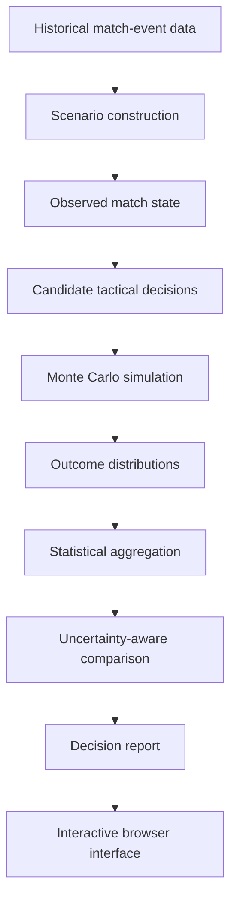

# System Architecture

## Overview

Fergie Time is an interactive football decision-simulation application. It combines historical match-event data, scenario construction, candidate tactical decisions, Monte Carlo simulation, uncertainty-aware evaluation, and a browser-based interface. The production implementation is private. This document describes the system conceptually without exposing proprietary implementation details.

## Main components

### 1. Historical match data

The application uses historical Premier League match-event information, including:

- Match results and scores.
- Match clock and event timing.
- Starting lineups and substitutions.
- Shot locations and expected-goal values.
- Player information.

This information provides the historical context from which a scenario begins.

### 2. Scenario construction

A scenario represents a match at a particular point in time. The application constructs a match state using relevant information such as:

- Current score.
- Match minute.
- Team and player availability.
- Red cards.
- Remaining substitutions.
- Historical events that have already occurred.

The scenario represents the observed state at the point where the user is asked to make a decision.

### 3. Candidate decision generation

The user selects tactical instructions or combinations of instructions. The application identifies the legal candidate options available from the current state. Candidate options are evaluated against the same underlying scenario so that their estimated outcomes can be compared.

### 4. Simulation execution

The simulation evaluates possible continuations of the match under each candidate decision. Repeated simulations produce an estimated distribution of outcomes rather than a single deterministic prediction. The production application uses a Web Worker to run simulation work separately from the main browser interface.

### 5. Statistical aggregation and comparison

The simulation results are summarized using quantities such as:

- Expected points.
- Win probability.
- Draw probability.
- Loss probability.
- Outcome variability.
- Differences between candidate decisions.
- Uncertainty estimates for paired comparisons.

The comparison logic is designed to avoid interpreting every small numerical difference as a meaningful advantage.

### 6. Result presentation

The browser interface communicates the decision evaluation and its trade-offs. It also allows users to:

- Enter a historical match scenario
- In the current game state:
    - Inspect the score, clock, and lineups 
    - Select tactical instructions
    - View the decision evaluation
    - Watch a simulated continuation
    - Review a decision report 
- Advance to the next game state and repeat until gameplay ends
- Review the final decision report at the end

## Conceptual data flow

The source diagram is maintained in [`../assets/architecture.mmd`](../assets/architecture.mmd).

## Evaluation workflow

Historical evaluation is a separate but related workflow:

1. Construct scenarios from historical match states.
2. Simulate their continuations.
3. Compare simulated outcomes with observed historical outcomes.
4. Aggregate diagnostics across match situations and seasons.
5. Identify groups where the simulation does not adequately represent observed outcomes.

The evaluation findings inform the scope in which the application uses historical scenarios.

## Observed history versus simulated future

The distinction between historical observations and counterfactual simulation is fundamental.

- Historical events establish what actually happened.
- The simulation estimates possible futures from a historical state.
- The decision report summarizes model-generated estimates.
- A simulated continuation is not an observed alternative history.

The application should communicate this distinction clearly rather than present simulated events as historical facts.